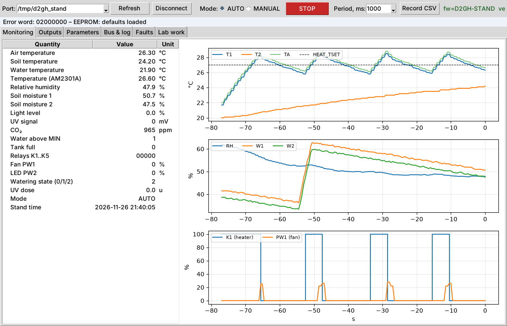

# D2.GreenHouse Stand

**English** | [Українська](README.uk.md)

Firmware and PC software that turn the **D2.GreenHouse** greenhouse controller
(STM32H723VET6 + STM32F030C8T6) into a **training and demonstration stand** for
students of technical colleges (junior bachelors) learning to use automatic
control systems: sensors, data transmission interfaces, control laws, actuators,
diagnostics.

Developed within the PhD research "Training of junior bachelors of technical
colleges to use automatic control systems" (specialty 015 Professional
Education), author Dmytro Dmytrenko, DDN Research.



## What the stand does

- measures air, soil and water temperature (DS18B20 via STM32F030), air humidity,
  soil moisture (2 channels, two-point calibration), light, UV, water level, CO₂ (RS-485 node);
- implements on-off control with hysteresis, proportional PWM control, scheduled
  control, watering with interlock, lighting by photoperiod and UV dose;
- protective interlocks in all modes (overheat, dry run, sensor failure), safe state by command or key;
- AUTO and MANUAL modes, manual control of every relay and PWM output;
- explains every switching with an event (`K1 ON T1=25.3 < 25.5`);
- RS-485 (protocol D2417/2) and M8SPI bus monitor;
- fault injection for diagnostics labs;
- PC program: live charts, parameters, CSV recording, step-by-step lab scenarios.

## Repository

| Folder | Content |
|---|---|
| `firmware/stm32h723` | C sources for STM32CubeIDE (application + board support) |
| `firmware/host_sim` | the same firmware built for Linux/macOS with a greenhouse model (no hardware needed) |
| `pc/python` | PC program (Python 3, tkinter, matplotlib, pyserial), lab scenarios |
| `docs/en`, `docs/uk` | documentation in English and Ukrainian |

## Quick start

**PC program with the real stand**
```
pip install -r pc/python/requirements.txt
python pc/python/d2gh_stand.py --lang en
```

**Without hardware (Linux/macOS)**
```
cd firmware/host_sim && make && SIM_SPEED=5 ./stand_sim
python pc/python/d2gh_stand.py --lang en --port /tmp/d2gh_stand
```

**Firmware**: see [docs/en/firmware.md](docs/en/firmware.md) (CubeMX settings, integration, flashing).

## Documentation

- [Firmware: architecture, CubeIDE project, assumptions to verify](docs/en/firmware.md)
- [PC ↔ stand protocol](docs/en/protocol.md)
- [PC program](docs/en/pc_program.md)
- [Hardware and pin map](docs/en/hardware.md)

## Status

Version 1.0.0. The firmware compiles for STM32H723 (arm-none-eabi-gcc, HAL) without warnings;
the application logic and the protocol were tested end-to-end with the host simulator
and the PC program. Testing on the physical controller and confirmation of the
protocol details listed in [firmware.md §6](docs/en/firmware.md) are the next step.

## Safety

Students work with 12 V DC only. The triac (mains) outputs of the controller are
switched off by the stand firmware and must be covered on the training panel.

## License

MIT, see [LICENSE](LICENSE).
