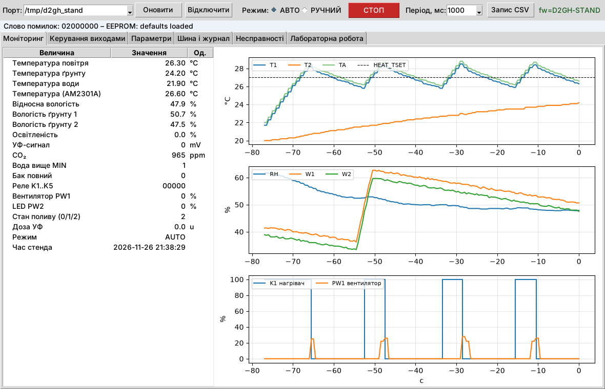

# Стенд D2.GreenHouse

[English](README.md) | **Українська**

Програмне забезпечення мікроконтролера і комп’ютера, що перетворює контролер
теплиці **D2.GreenHouse** (STM32H723VET6 + STM32F030C8T6) на **навчально-демонстраційний
стенд** для підготовки молодших бакалаврів технічних коледжів до використання
автоматичних систем керування: датчики, інтерфейси передачі даних, закони
керування, виконавчі пристрої, діагностика.

Розроблено в межах дисертаційного дослідження «Підготовка молодших бакалаврів
технічних коледжів до використання автоматичних систем керування»
(спеціальність 015 Професійна освіта), автор – Дмитро Дмитренко, DDN Research.



## Можливості стенда

- вимірювання температури повітря, ґрунту і води (DS18B20 через STM32F030), вологості
  повітря, вологості ґрунту (2 канали, двоточкове калібрування), освітленості, УФ,
  рівня води, CO₂ (вузол RS-485);
- двопозиційне регулювання з гістерезисом, пропорційне ШІМ-керування, програмне
  керування за розкладом, полив із блокуванням, освітлення за фотоперіодом і доза УФ;
- захисні блокування в усіх режимах (перегрів, «сухий хід» насоса, відмова датчика),
  безпечний стан за командою або кнопкою;
- режими АВТО і РУЧНИЙ, ручне керування кожним реле і ШІМ-виходом;
- пояснення кожного перемикання подією (`K1 ON T1=25.3 < 25.5`);
- монітор шин RS-485 (протокол D2417/2) і M8SPI;
- імітація несправностей для лабораторної роботи з діагностики;
- програма для ПК: графіки, параметри, запис CSV, покрокові сценарії лабораторних робіт.

## Склад репозиторію

| Тека | Вміст |
|---|---|
| `firmware/stm32h723` | вихідні коди на C для STM32CubeIDE (прикладна частина + підтримка плати) |
| `firmware/host_sim` | та сама прошивка, зібрана для Linux/macOS з моделлю теплиці (без апаратури) |
| `pc/python` | програма для ПК (Python 3, tkinter, matplotlib, pyserial), сценарії лабораторних робіт |
| `docs/uk`, `docs/en` | документація українською та англійською |

## Швидкий старт

**Програма для ПК і реальний стенд**
```
pip install -r pc/python/requirements.txt
python pc/python/d2gh_stand.py
```

**Без апаратури (Linux/macOS)**
```
cd firmware/host_sim && make && SIM_SPEED=5 ./stand_sim
python pc/python/d2gh_stand.py --port /tmp/d2gh_stand
```

**Прошивка**: див. [docs/uk/firmware.md](docs/uk/firmware.md) (налаштування CubeMX, інтеграція, програмування).

## Документація

- [Прошивка: архітектура, проєкт CubeIDE, припущення для перевірки](docs/uk/firmware.md)
- [Протокол обміну ПК ↔ стенд](docs/uk/protocol.md)
- [Програма для ПК](docs/uk/pc_program.md)
- [Апаратура і розпіновка](docs/uk/hardware.md)

## Стан розроблення

Версія 1.0.0. Прошивка компілюється для STM32H723 (arm-none-eabi-gcc, HAL) без попереджень;
прикладна логіка і протокол перевірені наскрізно за допомогою симулятора і програми
для ПК. Наступний крок – перевірка на фізичному контролері і підтвердження деталей
протоколів, наведених у [firmware.md §6](docs/uk/firmware.md).

## Безпека

Здобувачі освіти працюють лише з напругою 12 В постійного струму. Симісторні (мережеві)
виходи контролера вимикаються прошивкою стенда і мають бути закриті на навчальній панелі.

## Ліцензія

MIT, див. [LICENSE](LICENSE).
