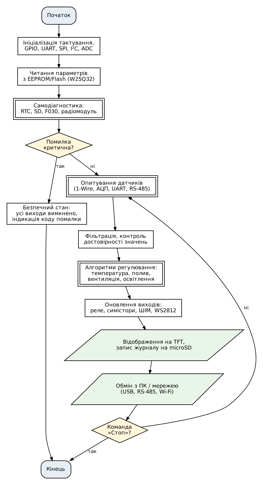

# Firmware of the stand (STM32H723VET6, C, STM32CubeIDE)

## 1. Structure

```
firmware/stm32h723/Core/
  Inc/app/   bsp.h board.h app.h params.h sensors.h control.h d2417.h proto.h
  Src/app/   app.c params.c sensors.c control.c d2417.c proto.c
  Src/bsp/   bsp_stm32.c          <- the only file that uses the HAL
firmware/stm32h723/integration/   snippets for main.c and usbd_cdc_if.c
firmware/host_sim/                same application code built for a PC + plant model
```

The application layer (`app/`) does not touch registers or HAL. It calls the
functions declared in `bsp.h`. There are two implementations:

| File | Target | Purpose |
|---|---|---|
| `bsp_stm32.c` | STM32H723VET6 | real stand |
| `host_sim/bsp_sim.c` | Linux / macOS | simulator: a model of the mini greenhouse, a pseudo-terminal port instead of USB |

So the control algorithms, the protocol and the parameters can be tested on a
PC with exactly the same code that runs on the microcontroller.

## 2. Main cycle

`App_Init()` switches all outputs off before enabling the 74AHC595 outputs, loads the
parameters from the EEPROM, and sends M8SPI mode 03h with all triac channels at 0 (mains outputs are never used). `App_Poll()` is a
cooperative scheduler:

| Period | Task |
|---|---|
| every loop | USB transmit, command parser, RS-485 polling state machine |
| 20 ms | keys (KEY1 AUTO/MANUAL, KEY2 STOP, KEY3/4 markers) |
| 100 ms | control laws + writing the outputs |
| 200 ms | analog inputs A1..A12 (2 × MCP3208) |
| 1000 ms | temperatures from STM32F030 (M8SPI), RTC, error word |
| STREAM_MS | telemetry line `#TEL` to the PC |



## 3. Control laws (control.c)

| Output | Law | Parameters |
|---|---|---|
| K1 air heater | on-off with hysteresis on T1 (fallback: TA) | HEAT_EN, HEAT_TSET, HEAT_HYST |
| K3 soil heater | on-off with hysteresis on T2 | HEAT_EN, GND_TSET, GND_HYST |
| PW1 fan | proportional: `D = MN + (MX − MN)·min(e,1)`, `e = max(eT, eRH, eCO2)` | VEN_* |
| K2 pump | moisture threshold, time limit, soak pause, **interlock by water level** | WAT_* |
| K5, PW2, WS2812 | photoperiod (RTC) and light level | BRG_* |
| K4 UV lamp | daily UV dose accumulation | UV_EN, UV_DOSE |

Interlocks work in AUTO **and** MANUAL modes: overheat (`SAFE_TMAX`) forces the
heaters off and the fan to maximum; no water forbids the pump; an invalid sensor
value switches its heater off. The relay minimum switching interval
`RELAY_MIN_S` protects the contacts (safety switch-off ignores it).
Every switching produces an event line such as `#EVT K1 ON T1=25.3 < 25.5` that explains *why* the output changed.

## 4. Creating the STM32CubeIDE project

1. *File → New → STM32 Project*, MCU **STM32H723VETx**.
2. **RCC**: HSE = Crystal (16 MHz). Clock tree: any SYSCLK accepted by CubeMX
   (e.g. 400–520 MHz); USB clock 48 MHz from **HSI48** with **CRS** (SOF sync).
3. **SYS**: Debug = Serial Wire; Timebase = SysTick.
4. **Cortex_M7**: ICache enabled; DCache may stay disabled.
5. **USB_OTG_HS**: *Internal FS Phy*, *Device_Only* (pins PA11/PA12).
   **Middleware → USB_DEVICE**: Class = *Communication Device Class (Virtual Port Com)*.
6. **I2C1**: Standard mode 100 kHz, pins **PB6 / PB7**.
7. **UART4**: Asynchronous, 9600 8N1, pins **PA0 / PA1**, NVIC: UART4 global interrupt **enabled**.
8. **TIM1**: CH1 *PWM Generation* (PE9), CH2 *PWM Generation* (PE11).
   **TIM3**: CH3 (PB0), CH4 (PB1). For both timers:
   *Prescaler* = (timer clock in MHz) − 1 → the counter runs at **1 MHz**;
   *Counter Period* = 1999 (500 Hz; the firmware changes it from `PWM_HZ`).
9. Leave all other pins unassigned — `bsp_init()` configures them.
10. Generate code. Copy `Core/Inc/app`, `Core/Src/app`, `Core/Src/bsp` into the
    project's `Core` folder (CubeIDE compiles subfolders of `Core/Src` automatically).
11. Add the lines from `integration/main_c_snippet.c` and
    `integration/usbd_cdc_if_snippet.c` between the `USER CODE` markers.
12. *Project Properties → C/C++ Build → Settings → MCU Settings*:
    tick **"Use float with printf from newlib-nano"**. Minimum stack size 0x1000.
13. Build, connect ST-LINK to the **MCU_PROG** connector (SWD), *Run*.
14. Connect USB-C to the PC: a virtual COM port appears (Windows 10/11 uses the
    built-in CDC driver). Start the PC program.

## 5. Host simulator

```
cd firmware/host_sim
make
SIM_SPEED=5 ./stand_sim            # port: /tmp/d2gh_stand
```
Then run `python pc/python/d2gh_stand.py --port /tmp/d2gh_stand`.
The simulator models the chamber air temperature (heater, fan losses), soil and
water temperature, air humidity, soil moisture (evaporation, pump), tank level,
day light, UV, CO₂ and two RS-485 nodes (CO₂ node at address 1, TS11 at address 2).

## 6. Assumptions to verify on the real hardware

The schematic fixes the wiring, but some protocol details are defined by the
firmware of the other devices. They are collected in single places so they are
easy to change:

| Item | Assumption in v1.0 | Where |
|---|---|---|
| M8SPI answer | answer bytes are clocked back during the DATA phase of the same frame; SPI mode 0, 50 kHz | `sensors.c m8_xfer`, `board.h M8_HALF_US` |
| M8SPI temperature | signed int16, 0.1 °C, valid −25…+125 °C | `sensors.c m8_temp` |
| AM2301A | read by STM32F030, **proposed** mode 04h `[RHH RHL TH TL ST]` | `sensors.c` (needs F030 support) |
| D2417/2 | DD and EE MSB first; G = XOR of A..F; request body `[01h]`; answer body `[type][VH VL ST]…` | `d2417.h/.c` |
| 74AHC595 /OE | active low, QA..QE = K1..K5 | `bsp_stm32.c` |
| PWM0..PWM3 | → terminals PW1..PW4, timer high = output on | `board.h PWM_ACTIVE_HIGH` |
| WaterControl | OUT_DATA levels connected to A11 (MIN) and A12 (MAX), > 2 V = water | `sensors.h AIN_LVLMIN/MAX` |
| Keys | TTP223B, active high | `board.h KEY_ACTIVE_HIGH` |
| U21 CH4 | 3.3 V rail monitor (divider R58/R60) | `sensors.c` |

Not used in v1.0: TFT display, microSD, Wi-Fi module, CAN, nRF24L01, internal
ADC path via CD4051B (the mux shares lines with the MCP3208 and stays inactive).
