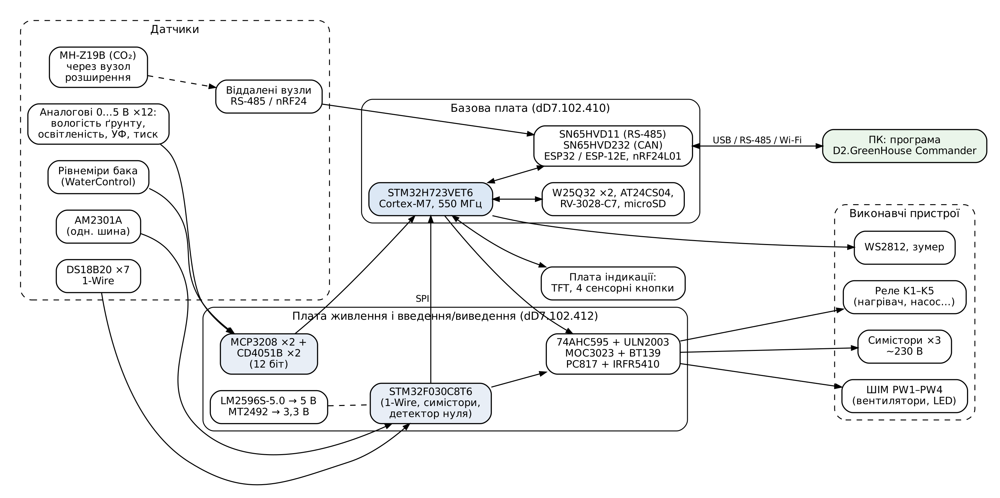

# Hardware used by the stand firmware

Controller D2.GreenHouse, KiCad project GreenHouse_4: base board dD7.102.410
(STM32H723VET6) and power/IO board dD7.102.412 (STM32F030C8T6, MCP3208 × 2,
relays, PWM outputs). The pin map was obtained from the schematic netlists.

## STM32H723VET6 pins used

| Function | Pins | Implementation |
|---|---|---|
| USB virtual COM port | PA11 D−, PA12 D+ | USB_OTG_HS, internal FS PHY, CDC |
| RS-485 (SN65HVD11) | PA0 TX, PA1 RX, PA15 DE | UART4 + GPIO |
| EEPROM AT24CS04, RTC RV-3028-C7 | PB6 SCL, PB7 SDA; PB8/PB9 EEPROM address = 0 | I2C1 |
| Relays K1..K5, LEDs D1/D2 (74AHC595 → ULN2003) | PD5 data, PD4 clock, PD3 latch, PD7 /OE | GPIO |
| MCP3208 U17/U21 (shared with CD4051B selects) | PC6 Din, PC7 Dout, PC4 CLK, PC5 HC51I | bit-banged SPI |
| Link to STM32F030 (M8SPI_V1.0) | PE12 SCK, PE13 MOSI, PE14 MISO, PB2 CS | bit-banged SPI |
| PWM outputs PW1..PW4 | PB1 TIM3_CH4, PB0 TIM3_CH3, PE11 TIM1_CH2, PE9 TIM1_CH1 | timers |
| WS2812 | PB15 | bit-banged, DWT timing |
| Buzzer | PD11 | GPIO |
| Keys KEY1..KEY4 | PE7, PE8, PE15, PE10 | GPIO |

HC51I is the /CS of U17 and, inverted by transistor Q9, the /CS of U21: one
converter is always selected, therefore every conversion starts by toggling HC51I.

## Analog inputs

Each terminal input A1..A12: divider 18 kΩ / 6.8 kΩ (Kd = 3.647), zener 5.1 V,
100 nF. MCP3208 reference: TL431 ≈ 2.495 V. Full scale at the terminal ≈ 9.1 V,
1 LSB ≈ 2.22 mV: `U_in = N · 2.495 V · 3.647 / 4096`.

| Terminal | A1 | A2 | A3 | A4 | A5 | A6 | A7 | A8 | A9 | A10 | A11 | A12 |
|---|---|---|---|---|---|---|---|---|---|---|---|---|
| J7 pin | 15 | 14 | 13 | 12 | 11 | 10 | 9 | 8 | 7 | 6 | 5 | 4 |
| ADC channel | U17.6 | U17.5 | U17.4 | U17.7 | U17.0 | U17.3 | U17.1 | U17.2 | U21.2 | U21.1 | U21.0 | U21.3 |
| Stand use | W1 soil | W2 soil | – | – | UV | light | – | – | – | – | level MIN | level MAX |

U21 CH4 monitors the 3.3 V rail; U21 CH6/CH7 are not connected.

## Assignment of actuators on the stand

| Output | Device (12 V only for students) |
|---|---|
| K1 | air heater |
| K2 | pump (blocked without water) |
| K3 | soil heater |
| K4 | UV lamp |
| K5 | grow light |
| PW1 | fan |
| PW2 | LED grow light (dimming) |
| PW3, PW4 | spare |
| LED terminal | WS2812 strip |
| triac outputs | **disabled** (mains voltage), set to 0 at start |
