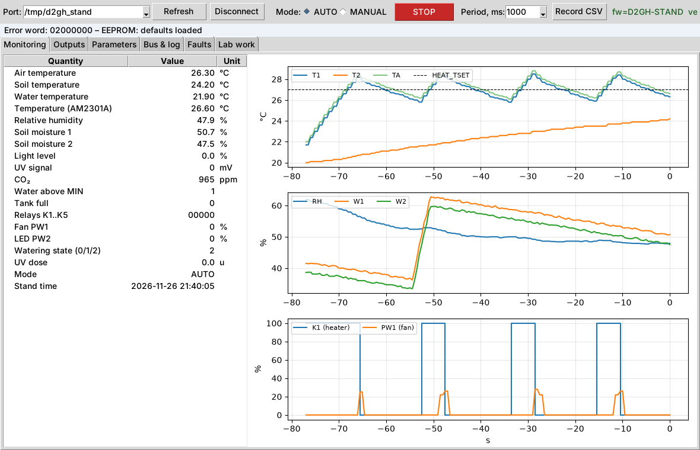
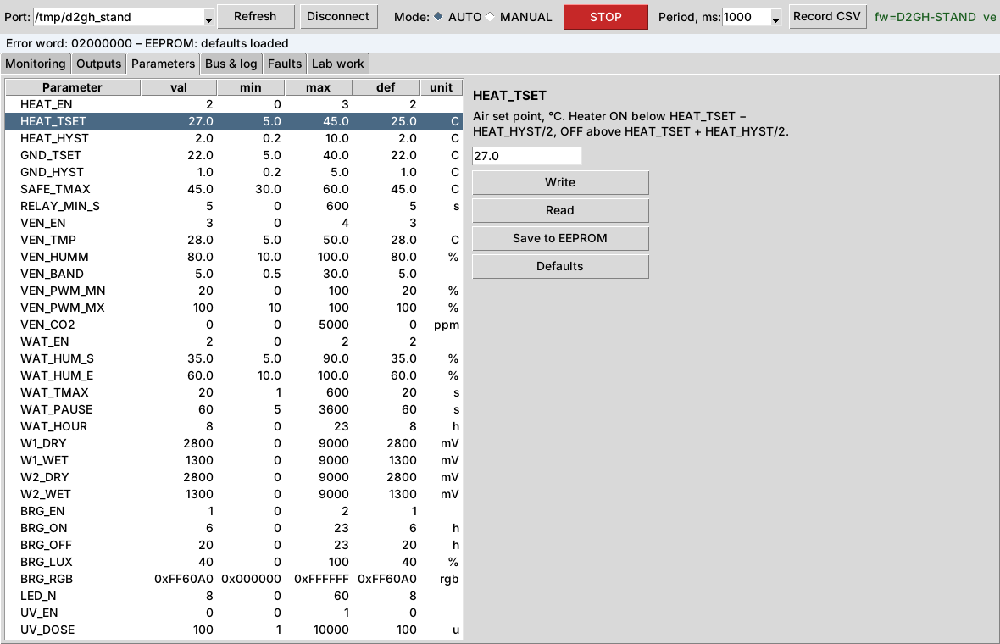
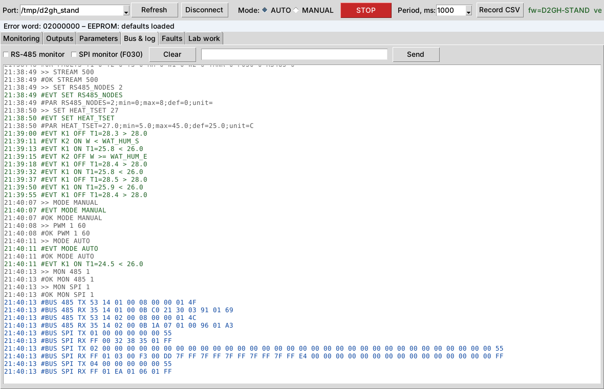
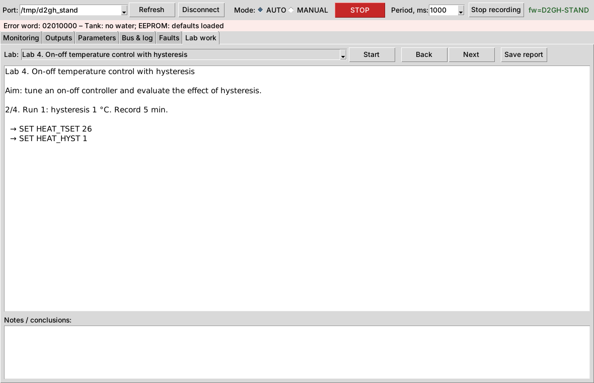

# PC program (Python)

## Installation

1. Python 3.8 or newer (Windows: tick *Add Python to PATH*, tkinter is included).
2. `pip install -r pc/python/requirements.txt` (pyserial, matplotlib).
3. Connect the stand by USB, then run
   `python pc/python/d2gh_stand.py` (Ukrainian UI) or `… --lang en`.
   Select the COM port (Windows `COMx`, Linux `/dev/ttyACM0`) and press **Connect**.

Without hardware: start the simulator (`firmware/host_sim`, Linux/macOS) and
select the port `/tmp/d2gh_stand`.

## Window

Top bar: port, connect, **mode AUTO / MANUAL**, red **STOP** (safe state),
telemetry period, **Record CSV**. Below it the decoded error word is always visible.

| Tab | Purpose |
|---|---|
| Monitoring | table of all measured values and three charts (10 min): temperatures with the set point, humidity and soil moisture, heater relay and fan PWM |
| Outputs | relays K1..K5, PWM sliders PW1..PW4, WS2812 colour, buzzer (MANUAL mode) |
| Parameters | all parameters with limits and defaults, help text, write / read / save to EEPROM |
| Bus & log | events with reasons, RS-485 and SPI monitor, terminal for manual commands |
| Faults | fault injection for the diagnostics lab, decoded error list |
| Lab work | step-by-step scenarios of labs 1–8 and the mini-project; commands of a step are sent automatically, measurements are recorded to `reports/*.csv`, notes are saved to a report file |






## Files

| File | Content |
|---|---|
| `d2gh_stand.py` | GUI (tkinter + matplotlib) |
| `stand_protocol.py` | serial link and protocol parser, usable from scripts |
| `labs/lab1.json … lab9.json` | lab scenarios (uk/en text, commands per step) |
| `params_help.json` | parameter descriptions (uk/en) |

A lab scenario is plain JSON, so a teacher can add new labs without programming:

```json
{"id": "lab4", "title": {"uk": "…", "en": "…"}, "aim": {"uk": "…", "en": "…"},
 "steps": [{"text": {"uk": "…", "en": "…"}, "cmd": ["SET HEAT_HYST 1"]}]}
```

A VB.NET version (Visual Studio 2010) with the same functions is planned; it
will use the same protocol.
