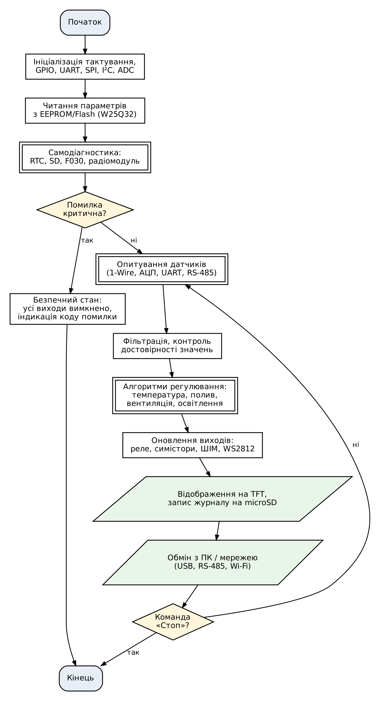

# Прошивка стенда (STM32H723VET6, C, STM32CubeIDE)

## 1. Структура

```
firmware/stm32h723/Core/
  Inc/app/   bsp.h board.h app.h params.h sensors.h control.h d2417.h proto.h
  Src/app/   app.c params.c sensors.c control.c d2417.c proto.c
  Src/bsp/   bsp_stm32.c          <- єдиний файл, що використовує HAL
firmware/stm32h723/integration/   фрагменти для main.c і usbd_cdc_if.c
firmware/host_sim/                той самий прикладний код, зібраний для ПК + модель об’єкта
```

Прикладна частина (`app/`) не звертається до регістрів і HAL, а викликає функції,
оголошені в `bsp.h`. Є дві реалізації:

| Файл | Платформа | Призначення |
|---|---|---|
| `bsp_stm32.c` | STM32H723VET6 | реальний стенд |
| `host_sim/bsp_sim.c` | Linux / macOS | симулятор: модель мінітеплиці, псевдотермінал замість USB |

Отже, алгоритми керування, протокол і параметри перевіряються на ПК тим самим
кодом, що виконується мікроконтролером.

## 2. Основний цикл

`App_Init()` вимикає всі виходи до дозволу виходів 74AHC595, завантажує параметри
з EEPROM і надсилає режим M8SPI 03h з нульовими значеннями всіх симісторних
каналів (мережеві виходи не використовуються). `App_Poll()` – кооперативний
планувальник:

| Період | Задача |
|---|---|
| кожен прохід | передача USB, розбір команд, автомат опитування RS-485 |
| 20 мс | кнопки (KEY1 АВТО/РУЧНИЙ, KEY2 СТОП, KEY3/4 мітки) |
| 100 мс | закони керування + запис виходів |
| 200 мс | аналогові входи A1..A12 (2 × MCP3208) |
| 1000 мс | температури від STM32F030 (M8SPI), годинник, слово помилок |
| STREAM_MS | рядок телеметрії `#TEL` на ПК |



## 3. Закони керування (control.c)

| Вихід | Закон | Параметри |
|---|---|---|
| K1 нагрівач повітря | двопозиційний з гістерезисом за T1 (резерв – TA) | HEAT_EN, HEAT_TSET, HEAT_HYST |
| K3 підігрів ґрунту | двопозиційний з гістерезисом за T2 | HEAT_EN, GND_TSET, GND_HYST |
| PW1 вентилятор | пропорційний: `D = MN + (MX − MN)·min(e,1)`, `e = max(eT, eRH, eCO2)` | VEN_* |
| K2 насос | поріг вологості, обмеження часу, пауза, **блокування за рівнем води** | WAT_* |
| K5, PW2, WS2812 | фотоперіод (RTC) і освітленість | BRG_* |
| K4 УФ-лампа | накопичення добової дози УФ | UV_EN, UV_DOSE |

Блокування діють у режимах АВТО **і** РУЧНИЙ: перегрів (`SAFE_TMAX`) примусово
вимикає нагрівачі і вмикає вентилятор на максимум; відсутність води забороняє
насос; недостовірне значення датчика вимикає відповідний нагрівач. Мінімальний
інтервал перемикання реле `RELAY_MIN_S` захищає контакти (на захисне вимкнення не
поширюється). Кожне перемикання супроводжується подією, наприклад
`#EVT K1 ON T1=25.3 < 25.5`, яка пояснює, *чому* змінився вихід.

## 4. Створення проєкту STM32CubeIDE

1. *File → New → STM32 Project*, мікроконтролер **STM32H723VETx**.
2. **RCC**: HSE = Crystal (16 МГц). Дерево тактування: будь-яка SYSCLK, яку приймає
   CubeMX (наприклад, 400–520 МГц); тактування USB 48 МГц від **HSI48** з **CRS** (синхронізація за SOF).
3. **SYS**: Debug = Serial Wire; Timebase = SysTick.
4. **Cortex_M7**: ICache увімкнено; DCache можна не вмикати.
5. **USB_OTG_HS**: *Internal FS Phy*, *Device_Only* (виводи PA11/PA12).
   **Middleware → USB_DEVICE**: Class = *Communication Device Class (Virtual Port Com)*.
6. **I2C1**: Standard mode 100 кГц, виводи **PB6 / PB7**.
7. **UART4**: Asynchronous, 9600 8N1, виводи **PA0 / PA1**, NVIC: переривання UART4 **увімкнено**.
8. **TIM1**: CH1 *PWM Generation* (PE9), CH2 *PWM Generation* (PE11).
   **TIM3**: CH3 (PB0), CH4 (PB1). Для обох таймерів:
   *Prescaler* = (тактова частота таймера в МГц) − 1 → лічильник працює на **1 МГц**;
   *Counter Period* = 1999 (500 Гц; прошивка змінює його за параметром `PWM_HZ`).
9. Інші виводи не призначати – їх налаштовує `bsp_init()`.
10. Згенерувати код. Скопіювати `Core/Inc/app`, `Core/Src/app`, `Core/Src/bsp` у теку
    `Core` проєкту (CubeIDE компілює підтеки `Core/Src` автоматично).
11. Додати рядки з `integration/main_c_snippet.c` та `integration/usbd_cdc_if_snippet.c`
    між маркерами `USER CODE`.
12. *Project Properties → C/C++ Build → Settings → MCU Settings*: позначити
    **«Use float with printf from newlib-nano»**. Мінімальний розмір стека 0x1000.
13. Зібрати, підключити ST-LINK до роз’єму **MCU_PROG** (SWD), *Run*.
14. Підключити USB-C до комп’ютера: з’явиться віртуальний COM-порт (Windows 10/11 –
    вбудований драйвер CDC). Запустити програму для ПК.

## 5. Симулятор на ПК

```
cd firmware/host_sim
make
SIM_SPEED=5 ./stand_sim            # порт: /tmp/d2gh_stand
```
Далі: `python pc/python/d2gh_stand.py --port /tmp/d2gh_stand`.
Симулятор моделює температуру повітря в камері (нагрівач, втрати з урахуванням
вентилятора), температуру ґрунту і води, вологість повітря, вологість ґрунту
(випаровування, насос), рівень у баці, денне світло, УФ, CO₂ і два вузли RS-485
(вузол CO₂ з адресою 1, TS11 з адресою 2).

## 6. Припущення, які слід перевірити на апаратурі

Схема однозначно визначає з’єднання, але частина деталей протоколів залежить від
програм інших пристроїв. Їх зібрано в окремих місцях коду, щоб їх легко було змінити:

| Пункт | Припущення у версії 1.0 | Де |
|---|---|---|
| Відповідь M8SPI | байти відповіді передаються під час фази DATA того самого кадру; SPI mode 0, 50 кГц | `sensors.c m8_xfer`, `board.h M8_HALF_US` |
| Температура M8SPI | знакове int16, 0,1 °C, допустимо −25…+125 °C | `sensors.c m8_temp` |
| AM2301A | читає STM32F030, **запропонований** режим 04h `[RHH RHL TH TL ST]` | `sensors.c` (потрібна підтримка в ПЗ F030) |
| D2417/2 | DD і EE – старшим байтом уперед; G = XOR байтів A..F; тіло запиту `[01h]`; тіло відповіді `[тип][VH VL ST]…` | `d2417.h/.c` |
| /OE 74AHC595 | активний низький рівень, QA..QE = K1..K5 | `bsp_stm32.c` |
| PWM0..PWM3 | → клеми PW1..PW4, високий рівень таймера = вихід увімкнено | `board.h PWM_ACTIVE_HIGH` |
| WaterControl | рівні OUT_DATA подано на A11 (MIN) і A12 (MAX), > 2 В = вода | `sensors.h AIN_LVLMIN/MAX` |
| Кнопки | TTP223B, активний високий рівень | `board.h KEY_ACTIVE_HIGH` |
| U21 CH4 | контроль шини 3,3 В (дільник R58/R60) | `sensors.c` |

У версії 1.0 не використовуються: TFT-дисплей, microSD, модуль Wi-Fi, CAN,
nRF24L01, канал вбудованого АЦП через CD4051B (мультиплексор має спільні лінії з
MCP3208 і залишається неактивним).
