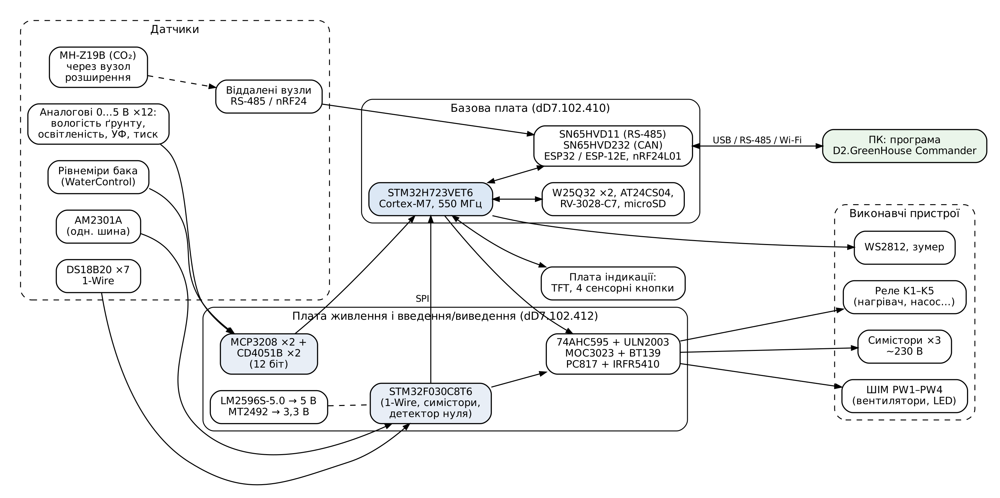

# Апаратура, яку використовує прошивка стенда

Контролер D2.GreenHouse, проєкт KiCad GreenHouse_4: базова плата dD7.102.410
(STM32H723VET6) і плата живлення та введення/виведення dD7.102.412 (STM32F030C8T6,
MCP3208 × 2, реле, ШІМ-виходи). Розпіновку отримано зі списків з’єднань схем.

## Використані виводи STM32H723VET6

| Функція | Виводи | Реалізація |
|---|---|---|
| Віртуальний COM-порт USB | PA11 D−, PA12 D+ | USB_OTG_HS, вбудований FS PHY, CDC |
| RS-485 (SN65HVD11) | PA0 TX, PA1 RX, PA15 DE | UART4 + GPIO |
| EEPROM AT24CS04, RTC RV-3028-C7 | PB6 SCL, PB7 SDA; PB8/PB9 адреса EEPROM = 0 | I2C1 |
| Реле K1..K5, світлодіоди D1/D2 (74AHC595 → ULN2003) | PD5 дані, PD4 такт, PD3 фіксація, PD7 /OE | GPIO |
| MCP3208 U17/U21 (спільно з входами вибору CD4051B) | PC6 Din, PC7 Dout, PC4 CLK, PC5 HC51I | програмний SPI |
| Зв’язок із STM32F030 (M8SPI_V1.0) | PE12 SCK, PE13 MOSI, PE14 MISO, PB2 CS | програмний SPI |
| ШІМ-виходи PW1..PW4 | PB1 TIM3_CH4, PB0 TIM3_CH3, PE11 TIM1_CH2, PE9 TIM1_CH1 | таймери |
| WS2812 | PB15 | програмно, відлік часу за DWT |
| Зумер | PD11 | GPIO |
| Кнопки KEY1..KEY4 | PE7, PE8, PE15, PE10 | GPIO |

Лінія HC51I є /CS для U17 і, через транзистор-інвертор Q9, /CS для U21: один з
перетворювачів завжди обраний, тому кожне перетворення починається з перемикання HC51I.

## Аналогові входи

Кожен вхід A1..A12: дільник 18 кОм / 6,8 кОм (Kд = 3,647), стабілітрон 5,1 В,
конденсатор 100 нФ. Опорна напруга MCP3208 – TL431 ≈ 2,495 В. Верхня межа на клемі
≈ 9,1 В, ціна розряду ≈ 2,22 мВ: `Uвх = N · 2,495 В · 3,647 / 4096`.

| Клема | A1 | A2 | A3 | A4 | A5 | A6 | A7 | A8 | A9 | A10 | A11 | A12 |
|---|---|---|---|---|---|---|---|---|---|---|---|---|
| Контакт J7 | 15 | 14 | 13 | 12 | 11 | 10 | 9 | 8 | 7 | 6 | 5 | 4 |
| Канал АЦП | U17.6 | U17.5 | U17.4 | U17.7 | U17.0 | U17.3 | U17.1 | U17.2 | U21.2 | U21.1 | U21.0 | U21.3 |
| На стенді | W1 ґрунт | W2 ґрунт | – | – | УФ | освітл. | – | – | – | – | рівень MIN | рівень MAX |

Канал U21 CH4 контролює шину 3,3 В; U21 CH6/CH7 не підключені.

## Призначення виконавчих пристроїв на стенді

| Вихід | Пристрій (для здобувачів – лише 12 В) |
|---|---|
| K1 | нагрівач повітря |
| K2 | насос (блокується без води) |
| K3 | підігрів ґрунту |
| K4 | УФ-лампа |
| K5 | досвічування |
| PW1 | вентилятор |
| PW2 | світлодіодне освітлення (регулювання яскравості) |
| PW3, PW4 | резерв |
| клема LED | стрічка WS2812 |
| симісторні виходи | **вимкнені** (мережева напруга), обнуляються під час запуску |
