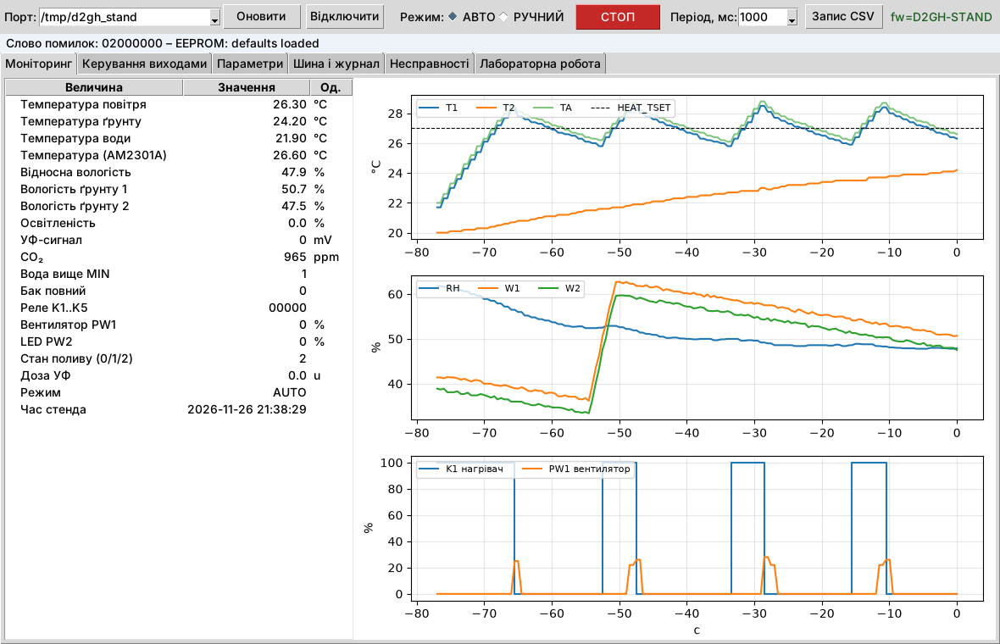
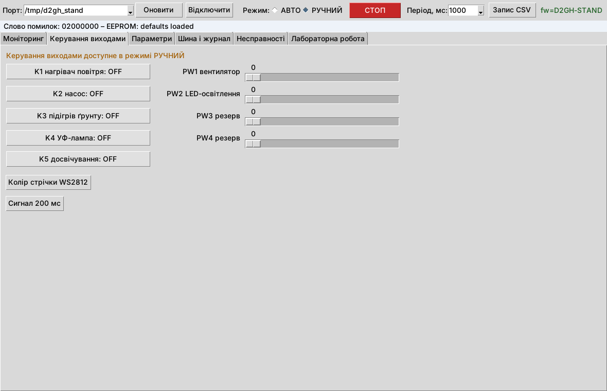
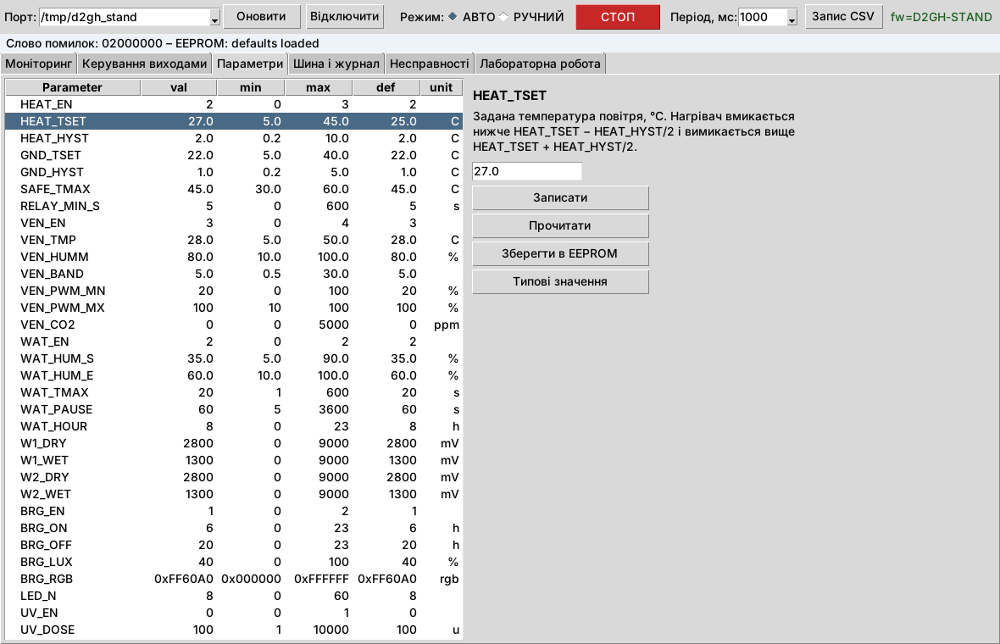
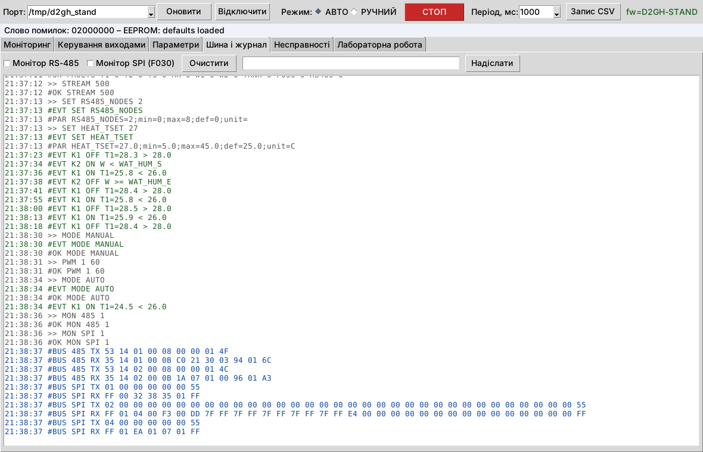
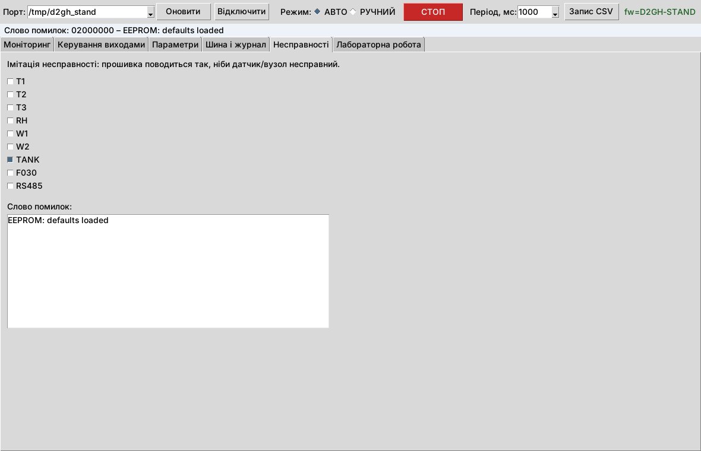
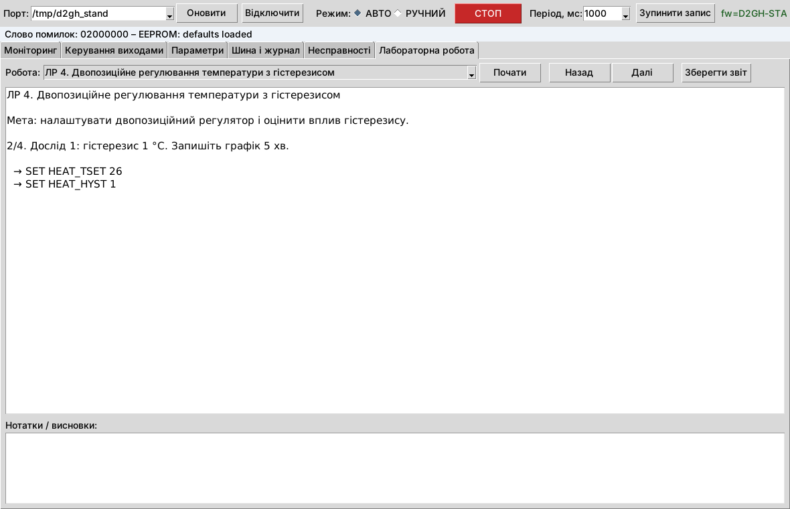

# Програма для ПК (Python)

## Встановлення

1. Python 3.8 або новіший (Windows: позначити *Add Python to PATH*, tkinter входить до складу).
2. `pip install -r pc/python/requirements.txt` (pyserial, matplotlib).
3. Підключити стенд через USB і запустити
   `python pc/python/d2gh_stand.py` (українська) або `… --lang en`.
   Обрати COM-порт (Windows `COMx`, Linux `/dev/ttyACM0`) і натиснути **Підключити**.

Без апаратури: запустити симулятор (`firmware/host_sim`, Linux/macOS) і обрати порт `/tmp/d2gh_stand`.

## Вікно програми

Верхня панель: порт, підключення, **режим АВТО / РУЧНИЙ**, червона кнопка **СТОП**
(безпечний стан), період телеметрії, **Запис CSV**. Під нею постійно відображається
розшифроване слово помилок.

| Вкладка | Призначення |
|---|---|
| Моніторинг | таблиця всіх вимірюваних величин і три графіки (10 хв): температури із заданим значенням; вологість повітря і ґрунту; реле нагрівача і ШІМ вентилятора |
| Керування виходами | реле K1..K5, повзунки ШІМ PW1..PW4, колір WS2812, зумер (режим РУЧНИЙ) |
| Параметри | усі параметри з межами і типовими значеннями, довідка, запис / читання / збереження в EEPROM |
| Шина і журнал | події з причинами, монітор RS-485 і SPI, термінал для ручних команд |
| Несправності | імітація несправностей для лабораторної роботи з діагностики, розшифрування помилок |
| Лабораторна робота | покрокові сценарії ЛР 1–8 і міні-проєкту; команди кроку надсилаються автоматично, вимірювання записуються в `reports/*.csv`, нотатки зберігаються у звіт |








## Файли

| Файл | Вміст |
|---|---|
| `d2gh_stand.py` | графічний інтерфейс (tkinter + matplotlib) |
| `stand_protocol.py` | зв’язок через послідовний порт і розбір протоколу, можна використовувати у скриптах |
| `labs/lab1.json … lab9.json` | сценарії лабораторних робіт (текст uk/en, команди кроків) |
| `params_help.json` | опис параметрів (uk/en) |

Сценарій лабораторної роботи – це звичайний файл JSON, тож викладач може додавати
нові роботи без програмування:

```json
{"id": "lab4", "title": {"uk": "…", "en": "…"}, "aim": {"uk": "…", "en": "…"},
 "steps": [{"text": {"uk": "…", "en": "…"}, "cmd": ["SET HEAT_HYST 1"]}]}
```

Версія на VB.NET (Visual Studio 2010) з тими самими функціями запланована;
вона використовуватиме той самий протокол.
